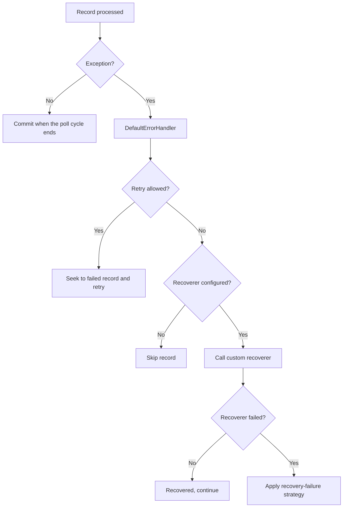
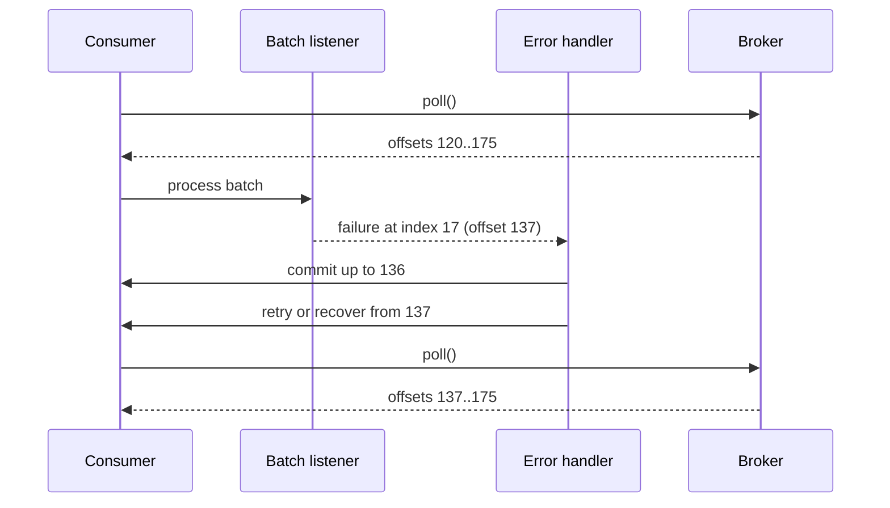

# FINT Kafka Library

[](https://github.com/FINTLabs/fint-kafka/actions/workflows/ci.yaml)

Spring Boot library for Kafka that provides:

- typed producer and consumer setup
- strict, consistent topic naming
- error handling for record and batch listeners
- request/reply over Kafka
- topic creation and configuration
- Kafka health indicators for liveness/readiness

Upgrading between major versions: see [docs/upgrading](docs/upgrading/README.md).

## Contents

1. [Getting started](#getting-started)
2. [Topic naming](#topic-naming)
3. [Producers](#producers)
4. [Consumers](#consumers)
5. [Error handling](#error-handling)
6. [Request/reply](#requestreply)
7. [Topic management](#topic-management)
8. [Health checks](#health-checks)
9. [Troubleshooting](#troubleshooting)

## Getting started

### Dependency

```kotlin
dependencies {
    implementation("no.novari:kafka:<version>")
}
```

See [releases](https://github.com/FINTLabs/fint-kafka/releases) for the latest version.

### Configuration

The library is auto-configured by Spring Boot. Minimum `application.yml`:

```yaml
spring:
  kafka:
    bootstrap-servers: localhost:9092
    consumer:
      group-id: my-consumer-group

novari:
  kafka:
    application-id: my-app
    default-replicas: 1
    topic:
      org-id: my-org
      domain-context: my-domain

fint:
  kafka:
    enable-ssl: false
```

| Property                            | Purpose                                                     |
|-------------------------------------|-------------------------------------------------------------|
| `novari.kafka.application-id`       | Value of the `origin.application.id` header on every record |
| `novari.kafka.default-replicas`     | Replication factor for created topics (default `2`)         |
| `novari.kafka.topic.org-id`         | Org id used by `orgIdApplicationDefault()`                  |
| `novari.kafka.topic.domain-context` | Domain context used by `domainContextApplicationDefault()`  |
| `fint.kafka.enable-ssl`             | `true` enables SSL using `spring.kafka.ssl.*`               |

The SSL flag and the [health settings](#health-checks) still use the `fint.kafka` prefix; everything else uses `novari.kafka`.

The library sets the consumer default `auto.offset.reset=earliest`. A consumer group without committed offsets therefore reads the topic from the start. See [Reading only new messages](#reading-only-new-messages) to override this.

### `stepBuilder` vs `builder`

Configuration objects with important choices have a `stepBuilder()` that walks you through every required decision in order. Prefer it.

- Only `stepBuilder`: `TopicNamePrefixParameters`, `TopicNamePatternPrefixParameters`, `EventTopicConfiguration`, `EntityTopicConfiguration`
- Both: `ListenerConfiguration`, `ErrorHandlerConfiguration`, `RequestListenerConfiguration`
- Only `builder`: records (`ParameterizedProducerRecord`, `RequestProducerRecord`, `ReplyProducerRecord`), `*TopicNameParameters` and the remaining topic configurations

## Topic naming

Topic names follow `<orgId>.<domainContext>.<messageType>.<suffix...>`:

- `my-org.my-domain.event.student-created`
- `my-org.my-domain.entity.student`
- `my-org.my-domain.request.student.by.fnr`
- `my-org.my-domain.reply.my-app.student`
- `my-org.my-domain.event.error.student-sync-failed`

Message types: `event`, `entity`, `request`, `reply`.

Topic names are built from `*TopicNameParameters` by `TopicNameService`, which validates that:

- required components are set and `orgId`/`domainContext` are not blank
- no component contains `.` or uppercase letters

The prefix is set explicitly per component: `orgId(value)`, `orgIdApplicationDefault()` (from `novari.kafka.topic.org-id`) or `orgIdCommon()` (`common`), and the same for `domainContext`.

### Pattern subscriptions

`TopicNamePatternService` builds a regex for subscribing to several topics at once:

```java
EventTopicNamePatternParameters params = EventTopicNamePatternParameters.builder()
    .topicNamePatternPrefixParameters(
        TopicNamePatternPrefixParameters.stepBuilder()
            .orgId(TopicNamePatternParameterPattern.anyOf("org1", "org2"))
            .domainContext(TopicNamePatternParameterPattern.anyOf("school", "hr"))
            .build()
    )
    .eventName(TopicNamePatternParameterPattern.startingWith("student"))
    .build();
```

`TopicNamePatternParameterPattern` also has `any()`, `exactly(..)`, `endingWith(..)`, `startingWithAnyOf(..)`, `endingWithAnyOf(..)` and `custom(Pattern)`.

## Producers

- `TemplateFactory`: plain `KafkaTemplate<String, VALUE>`
- `ParameterizedTemplateFactory`: `ParameterizedTemplate<VALUE>` that sends to a topic built from `TopicNameParameters`

```java
ParameterizedTemplate<MyEvent> template =
    parameterizedTemplateFactory.createTemplate(MyEvent.class);

template.send(
    ParameterizedProducerRecord.<MyEvent>builder()
        .topicNameParameters(
            EventTopicNameParameters.builder()
                .topicNamePrefixParameters(
                    TopicNamePrefixParameters.stepBuilder()
                        .orgIdApplicationDefault()
                        .domainContextApplicationDefault()
                        .build()
                )
                .eventName("student-created")
                .build()
        )
        .key("student-123")
        .value(new MyEvent(...))
        .build()
);
```

Every record gets the header `origin.application.id` with the value of `novari.kafka.application-id`, added by `OriginHeaderProducerInterceptor`.

## Consumers

### Factories

- `ListenerContainerFactoryService`: `createRecordListenerContainerFactory(..)` and `createBatchListenerContainerFactory(..)`, subscribing by topic name
- `ParameterizedListenerContainerFactoryService`: the same, but `createContainer(..)` takes `TopicNameParameters`, a collection of them, or `TopicNamePatternParameters`

Containers must be started explicitly:

```java
ConcurrentMessageListenerContainer<String, MyEvent> container =
    parameterizedListenerContainerFactoryService
        .createRecordListenerContainerFactory(
            MyEvent.class,
            record -> process(record.value()),
            listenerConfiguration,
            errorHandlerFactory.createErrorHandler(
                ErrorHandlerConfiguration.<MyEvent>stepBuilder()
                    .noRetries()
                    .skipFailedRecords()
                    .build()
            )
        )
        .createContainer(topicNameParameters);

container.start();
```

### ListenerConfiguration

```java
ListenerConfiguration cfg = ListenerConfiguration.stepBuilder()
    .groupIdApplicationDefault()
    .maxPollRecords(100)
    .maxPollInterval(Duration.ofMinutes(10))
    .continueFromPreviousOffsetOnAssignment()
    .build();
```

Steps, in order:

1. Group id: `groupIdApplicationDefault()`, `groupIdApplicationDefaultWithSuffix(String)` or `groupIdApplicationDefaultWithUniqueSuffix()`
2. `maxPollRecords(n)` or `maxPollRecordsKafkaDefault()`
3. `maxPollInterval(duration)` or `maxPollIntervalKafkaDefault()`
4. On assignment: `continueFromPreviousOffsetOnAssignment()`, `seekToBeginningOnAssignment()` or `onAssignment((assignments, callback) -> ...)`
5. Optional: `onRevocation(..)`, `offsetSeekingTrigger(trigger)`

### Choosing a group id

The group id decides load sharing and where the consumer resumes.

| Option                                        | Load sharing across instances | Resumes after restart | Replay on startup |
|-----------------------------------------------|-------------------------------|-----------------------|-------------------|
| `groupIdApplicationDefault()`                 | Yes                           | Yes                   | No                |
| `groupIdApplicationDefaultWithUniqueSuffix()` | No                            | No                    | Yes (full)        |
| `groupIdApplicationDefaultWithSuffix(String)` | Yes (per suffix)              | Yes                   | No                |

- `groupIdApplicationDefault()`: the normal choice. Uses `spring.kafka.consumer.group-id` unchanged.
- `groupIdApplicationDefaultWithUniqueSuffix()`: appends a random UUID on every startup, so each instance gets every message and replays the whole topic. Use it to build an in-memory cache from a compacted entity topic, or in tests. Each startup leaves an abandoned consumer group behind, and replaying large topics slows startup.
- `groupIdApplicationDefaultWithSuffix(String)`: a stable but separate group id. Use it when one application has several independent consumers on the same topic, each needing its own offsets.

The suffix is appended without a separator; include one yourself, e.g. `"-cache"`.

### Offset on assignment

- `continueFromPreviousOffsetOnAssignment()`: the normal choice for durable processing.
- `seekToBeginningOnAssignment()`: rebuilds state from the whole topic on every assignment. Usually combined with `groupIdApplicationDefaultWithUniqueSuffix()` for caches.
- `onAssignment(..)`: escape hatch for seeking to a specific offset or timestamp via `ConsumerSeekCallback`.

`OffsetSeekingTrigger` re-reads a topic at runtime without a restart, e.g. from an admin endpoint that rebuilds a cache:

```java
OffsetSeekingTrigger trigger = new OffsetSeekingTrigger();

ListenerConfiguration cfg = ListenerConfiguration.stepBuilder()
    .groupIdApplicationDefault()
    .maxPollRecordsKafkaDefault()
    .maxPollIntervalKafkaDefault()
    .continueFromPreviousOffsetOnAssignment()
    .offsetSeekingTrigger(trigger)
    .build();

// later:
trigger.seekToBeginning();
```

### Poll settings

`maxPollInterval` must be comfortably larger than `maxPollRecords × worst-case processing time per record`. Otherwise the group considers the consumer dead, rebalances, and another consumer processes the same records again.

- Fast processing: keep the Kafka defaults (500 records / 5 minutes).
- Slow processing (external calls, heavy writes): lower `maxPollRecords` and, if needed, raise `maxPollInterval`. Example: 100 records × 5 s worst case ≈ 8.3 minutes, so the 5-minute default is too short.

### Concurrency

`concurrency` is the number of consumer threads a container starts in the same consumer group. Partitions are split between them, so threads beyond the number of partitions sit idle. Start with the default (1) and raise it only when you see consumer lag and the topic has enough partitions.

Set it through the `containerCustomizer` argument, or on the container before `start()`:

```java
parameterizedListenerContainerFactoryService.createRecordListenerContainerFactory(
    MyEvent.class,
    record -> process(record.value()),
    listenerConfiguration,
    errorHandler,
    container -> container.setConcurrency(6)
);
```

Request and reply topics are created with one partition, so `concurrency > 1` gives no extra parallelism there. Ordering is only guaranteed within a partition.

### Reading only new messages

To start a new consumer group at the end of the topic instead of the beginning, override `auto.offset.reset` per container:

```java
listenerContainerFactoryService
    .createRecordListenerContainerFactory(
        MyValue.class,
        record -> { /* ... */ },
        listenerConfiguration,
        errorHandler,
        c -> c.getContainerProperties()
              .getKafkaConsumerProperties()
              .setProperty(ConsumerConfig.AUTO_OFFSET_RESET_CONFIG, "latest")
    )
    .createContainer("my-topic");
```

Or override the `ConsumerConfig` bean for the whole application.

### Record or batch listener

- **Record listener** (default choice): receives one `ConsumerRecord` at a time. Error handling is per record, and records processed before a failure are committed.
- **Batch listener**: receives `List<ConsumerRecord<..>>`. Use it for bulk work such as batch inserts. Throw `BatchListenerFailedException(message, index)` on failure so only the failing record and the rest of the batch are retried; any other exception fails the whole batch.

## Error handling

`ErrorHandlerFactory.createErrorHandler(ErrorHandlerConfiguration)` builds a `DefaultErrorHandler`.

Retrying blocks the partition: no records behind the failing one are processed until it succeeds or is recovered.

### Steps in `ErrorHandlerConfiguration.stepBuilder()`

1. **Retry strategy**
   - `noRetries()`: for deterministic failures, such as validation errors, that will fail again.
   - `retryWithFixedInterval(interval, maxRetries)`: for short, transient failures. Keep both values low.
   - `retryWithExponentialInterval(..)`: when a downstream service may be down for a while.
   - `retryWithBackoffFunction(..)`: when the backoff depends on the record or exception. Rarely needed.
2. **Retry classification**
   - `excludeExceptionsFromRetry(..)` or `retryOnly(..)`: exclude deterministic failures, such as deserialization errors, from retry.
   - `useDefaultRetryClassification()`: when every expected failure is transient.
3. **When the exception changes during retry**
   - `restartRetryOnExceptionChange()`: a new exception type gets its own attempts. A good default.
   - `continueRetryOnExceptionChange()`: keeps total retry time bounded.
4. **Recovery after retries are exhausted**
   - `skipFailedRecords()`: log and skip. For data where losing a message is acceptable.
   - `recoverFailedRecords(..)`: custom recoverer, e.g. write to an error topic or database.
5. **If the recoverer fails**
   - `skipRecordOnRecoveryFailure()`: progress over completeness.
   - `reprocessAndRetryRecordOnRecoveryFailure()`: never lose a message. A record that always fails blocks the partition indefinitely.
   - `reprocessRecordOnRecoveryFailure()`: reprocess once without restarting the retry sequence.

### Record listener flow



### Batch listener flow

With `BatchListenerFailedException` at index 17 of a batch with offsets `120..175`:



With any other exception, the whole batch is retried, and recovery runs for every record in the batch.

## Request/reply

### Requesting side

`RequestTemplateFactory.createTemplate(replyTopicNameParameters, requestValueClass, replyValueClass, replyTimeout, replyListenerConfiguration)` creates a `RequestTemplate` with its own reply listener, started automatically.

- `requestAndReceive(requestProducerRecord)`: blocks until the reply arrives
- `requestWithAsyncReplyConsumer(requestProducerRecord, replyConsumer, failureConsumer)`: asynchronous

A missing reply within `replyTimeout` fails with `KafkaReplyTimeoutException`.

### Replying side

`RequestListenerContainerFactory.createRecordConsumerFactory(requestValueClass, replyValueClass, replyFunction, requestListenerConfiguration, errorHandler)` returns a container factory. For each request, `replyFunction` returns a `ReplyProducerRecord`, which is sent to the topic in the `KafkaHeaders.REPLY_TOPIC` header with the request's `KafkaHeaders.CORRELATION_ID`.

```java
RequestListenerConfiguration<MyRequest> cfg =
    RequestListenerConfiguration.stepBuilder(MyRequest.class)
        .maxPollRecordsKafkaDefault()
        .maxPollIntervalKafkaDefault()
        .build();
```

## Topic management

### Entity topic or event topic?

- **Entity topic** (`cleanup.policy=compact`): latest state per key. Use it for state, such as a student, where only the current value matters. Requires a stable, meaningful key. Send `null` as the value to delete a key (tombstone).
- **Event topic** (`cleanup.policy=delete`): everything that happened, kept for the retention time. Use it when every event matters on its own.

### Services

- `EventTopicService` with `EventTopicConfiguration`
- `EntityTopicService` with `EntityTopicConfiguration`
- `ErrorEventTopicService` for error event topics
- `RequestTopicService` and `ReplyTopicService`: one partition, 6 h segments
- `TopicService.createOrModifyTopic(name, TopicConfiguration)` for plain topic names

```java
EventTopicConfiguration cfg = EventTopicConfiguration.stepBuilder()
    .partitions(1)
    .retentionTime(Duration.ofDays(7))
    .cleanupFrequency(EventCleanupFrequency.NORMAL)
    .build();
```

`cleanupFrequency` sets how often segments roll, which decides how soon retention and compaction take effect. Kafka only cleans closed segments.

| Frequency  | Event `segment.ms` | Entity `segment.ms` | Entity `max.compaction.lag.ms` |
|------------|--------------------|---------------------|--------------------------------|
| `FREQUENT` | 6 h                | 3 h                 | 6 h                            |
| `NORMAL`   | 12 h               | 12 h                | 24 h                           |
| `RARE`     | 24 h               | 24 h                | 48 h                           |

Use `NORMAL` unless the topic has high volume or short retention (`FREQUENT`), or low volume (`RARE`).

`TopicConfiguration` maps to Kafka topic config like this:

| `TopicConfiguration`                          | Kafka topic config                                            |
|-----------------------------------------------|---------------------------------------------------------------|
| `deleteCleanupPolicy.retentionTime`           | `cleanup.policy=delete` + `retention.ms`                      |
| `compactCleanupPolicy.maxCompactionLag`       | `cleanup.policy` includes `compact` + `max.compaction.lag.ms` |
| `compactCleanupPolicy.nullValueRetentionTime` | `delete.retention.ms`                                         |
| `segmentConfiguration.openSegmentDuration`    | `segment.ms`                                                  |

## Health checks

An application can keep running with a dead Kafka connection (wrong ACL, missing SSL flag, broker down). The library exposes two Spring Boot Actuator health indicators so such failures restart or unready the pod, while tolerating transient failures such as rebalances and short outages.

- `kafkaConsumersHealthIndicator` (`liveness`): `DOWN` immediately when a consumer container stops with a reason other than `NORMAL` (e.g. `AUTH`), or when an auto-startup container is no longer running. Rebalances never trigger it.
- `kafkaConnectivityHealthIndicator` (`readiness`): `DOWN` when `AdminClient.describeCluster` fails `failure-threshold` times in a row, or when producer sends fail repeatedly. A pod is not ready until the cluster is reachable.

How long an outage must last before the pod is affected also depends on the probe's `failureThreshold` and `periodSeconds` in Kubernetes.

The module is enabled when `spring-boot-starter-actuator` is on the classpath. The library adds the indicators to the `liveness` and `readiness` groups itself.

Defaults:

```yaml
fint:
  kafka:
    health:
      enabled: true
      connectivity:
        timeout: 5s            # describeCluster timeout
        cache-ttl: 10s         # minimum time between active checks
        failure-threshold: 4   # consecutive failures before DOWN (~40 s outage)
      producer:
        failure-threshold: 5   # send failures within the window before DOWN
        failure-window: 2m
```

An application serving an HTTP API that should stay in rotation during Kafka outages can set `management.endpoint.health.group.readiness.include` itself; the library only sets it when the application has not.

## Troubleshooting

**No messages received**

- Is the container started (`container.start()`)?
- Has the group id already committed offsets past the messages? Try `seekToBeginningOnAssignment()`.

**Batch retry starts from the wrong record**

- Throw `BatchListenerFailedException` with the index of the failing record. Other exceptions retry the whole batch.

**Partition stuck on one record**

- A record that fails both processing and recovery with `reprocessAndRetryRecordOnRecoveryFailure()` blocks forever. Exclude deterministic exceptions from retry, or use `skipRecordOnRecoveryFailure()`.
